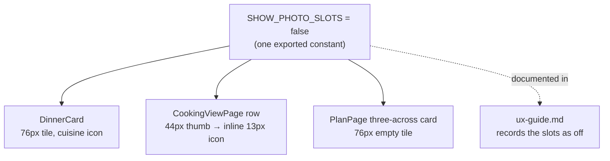

# Hide Photo Slots: System Context

## System Overview

This is entirely in the React PWA. Three components draw a photo slot today. All three will check
one shared constant and skip the slot while it is `false`. No data, query, table or Edge Function
changes.

## Actors

- **Household member browsing the catalog**: sees dinner cards without the 76px tile.
- **Household member cooking**: sees cooking-view rows without the 44px thumb, with the cuisine icon
  moved into the meta row.
- **Household member planning the week**: sees This week cards without the empty tile.
- **Developer**: turns the slots back on by changing one constant when photos arrive.

## External Systems

- **Supabase Postgres**: unchanged. There is still no image field on any dinner.
- **claude-proxy Edge Function**: unchanged.

## Data Flows

None new. The constant is decided when the code is built, not fetched while the app runs.

## Context Diagram

