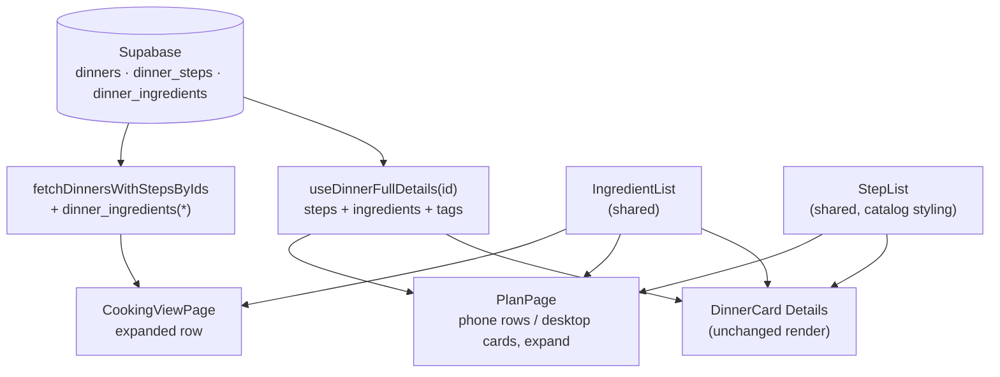

# Ingredients on This Week and Cook: System Context

## System Overview

This is entirely in the React PWA. The catalog card's ingredient and step lists become shared
components. This week gains an expand that renders them, and the Cook tab's expand adds the
ingredient list above its steps. One query changes: the Cook tab's select gains
`dinner_ingredients(*)`. There's no table, RLS or Edge Function change.

## Actors

- **Household member planning the week**: opens a picked dinner on This week, for the current week
  or a past one, to see what goes into it and how it's made.
- **Household member cooking**: opens a row on the Cook tab and sees the ingredients to gather
  before the steps.

## External Systems

- **Supabase Postgres**: read only. `dinners`, `dinner_steps` and `dinner_ingredients` are
  already readable under the household's RLS.
- **claude-proxy Edge Function**: unchanged.

## Data Flows

- **This week**: expanding a dinner enables `useDinnerFullDetails(dinnerId, true)`. That's one
  request per dinner, under the catalog's `dinnerDetailsKey`, so it's shared with the catalog
  card's cache. On desktop, one expand opens all three cards, so up to three requests go out in
  parallel.
- **Cook tab**: `fetchDinnersWithStepsByIds` selects `*, dinner_steps(*), dinner_ingredients(*)`.
  It's still one request, made when the week is full, as now.

## Context Diagram

