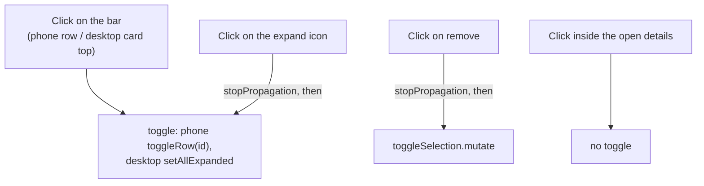

# Tap Row to Expand: System Context

## System Overview

This is entirely in the React PWA, in one component: `PlanPage.tsx`. The bar of each picked dinner
on This week gets a click handler that does what the expand button does. No data, query, schema,
RLS or Edge Function change.

## Actors

- **Household member planning the week**: taps a picked dinner's bar to see its ingredients and
  steps, on a phone or a desktop.

## External Systems

None changed. Expanding still loads details through `useDinnerFullDetails`, as in intent 026.

## Event Flow

